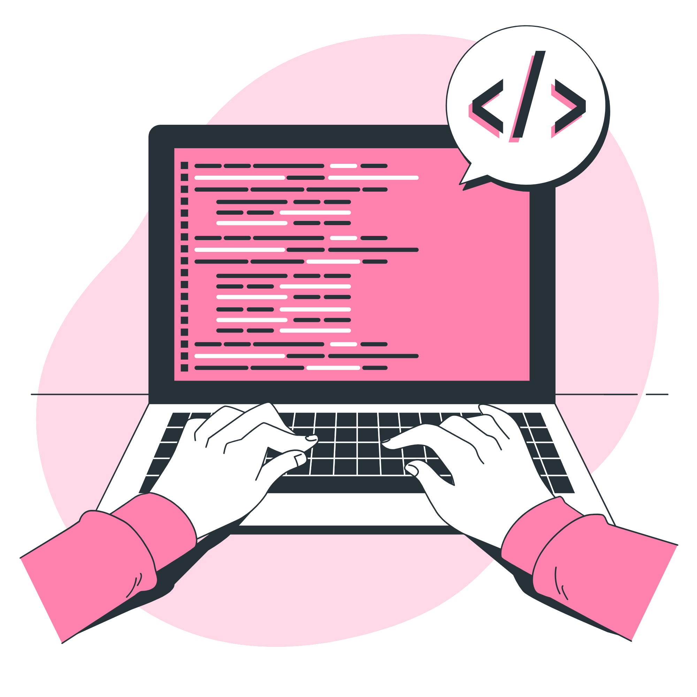

<h1>Hi, I'm Lais 👋</h1>

Ruby on Rails Developer

### ☺️ about me
Currently at Pitzi, working on legacy and modern Rails apps.  
I enjoy untangling old code and finding simple, reusable solutions to problems that keep coming up,
and I'm pursuing my bachelor's degree in Computer Science.

### ⚙️ tech stack
  - **Backend:** Ruby, Ruby on Rails (3.2 to 8), REST APIs, PostgreSQL, webhooks, payment gateways;
  - **Testing:** RSpec, Capybara, TDD;
  - **Frontend:** Tailwind, JavaScript, server-side datatables;
  - **Tools:** Git, GitHub Actions, Jenkins, Docker, Rollbar;
  - **Artificial Intelligence:** Cursor, Claude, harnesses.

### 💬 contact
📍 Brazil | Remote 
🔗 LinkedIn: https://www.linkedin.com/in/lais-santos-almeida/  
📧 E-mail: <a href="mailto:laisdev25@gmail.com">laisdev25@gmail.com</a> 

  <a href="./README.pt-br.md">🇧🇷 portuguese</a>

