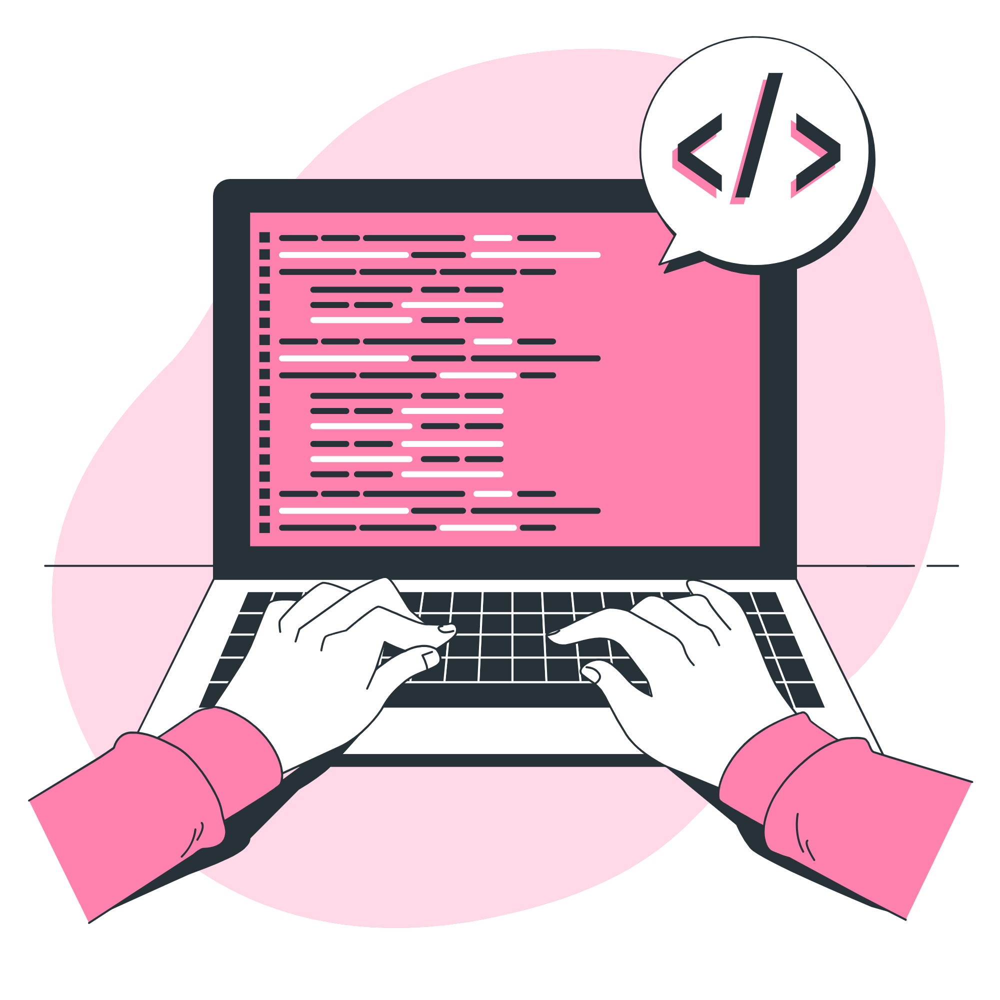

<h1>Oi, eu sou a Lais 👋</h1>

Desenvolvedora Ruby on Rails 

### ☺️ sobre mim
Atualmente na Pitzi, trabalhando com aplicações Rails legados e modernos.  
Gosto de desembaraçar código antigo e de encontrar soluções simples e reutilizáveis para problemas que se repetem, e estou cursando Bacharelado em Ciência da Computação.

### ⚙️ tech stack
- **Backend:** Ruby, Ruby on Rails (3.2 a 8), REST APIs, PostgreSQL, webhooks, gateways de pagamento;
- **Testes:** RSpec, Capybara, TDD;
- **Frontend:** Tailwind, JavaScript, datatables server-side;
- **Ferramentas:** Git, GitHub Actions, Jenkins, Docker, Rollbar;
- **Inteligência Artificial:** Cursor, Claude, harnesses.

### 💬 contato
📍 Brasil | Remoto  
🔗 LinkedIn: https://www.linkedin.com/in/lais-santos-almeida/  
📧 E-mail: <a href="mailto:laisdev25@gmail.com">laisdev25@gmail.com</a>  

  <a href="./README.md">🇺🇸 inglês</a>

