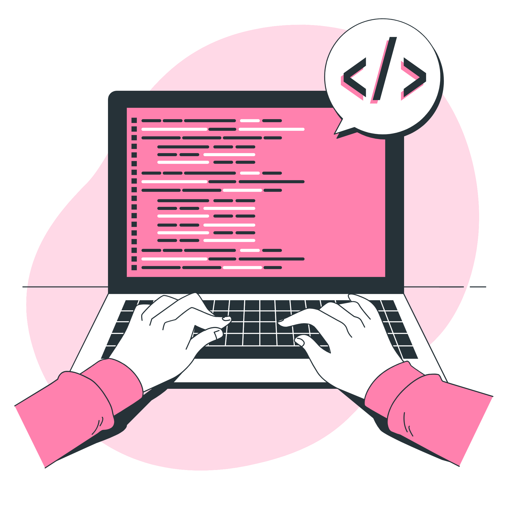

<h1>Oi, eu sou a Lais 👋</h1>

Engenheira de Software | Ruby on Rails 

### ☺️ sobre mim
Sou uma **engenheira de software Ruby on Rails**, atualmente trabalhando na Pitzi em sistemas em produção.  
Tenho experiência com aplicações Rails legadas e modernas, com foco em desenvolvimento backend, refatoração e 
qualidade de código.  
Atuo na construção e manutenção de APIs REST, webhooks e integrações de gateways de pagamento.

### ⚙️ tech stack

- **Backend:** Ruby, Ruby on Rails
- **APIs:** REST APIs, Webhooks, Integrações de Pagamento
- **Testes:** RSpec, Capybara, TDD
- **DevOps:** Git, GitHub Actions, CI/CD, Docker
- **Banco de Dados:** PostgreSQL, SQLite

#### 💬 contact
📍 Brasil | Aberta a oportunidades remotas  
🔗 LinkedIn: https://www.linkedin.com/in/lais-santos-almeida/  
📧 E-mail: laisdev25@gmail.com  

  <a href="./README.md">🇺🇸 inglês</a>

